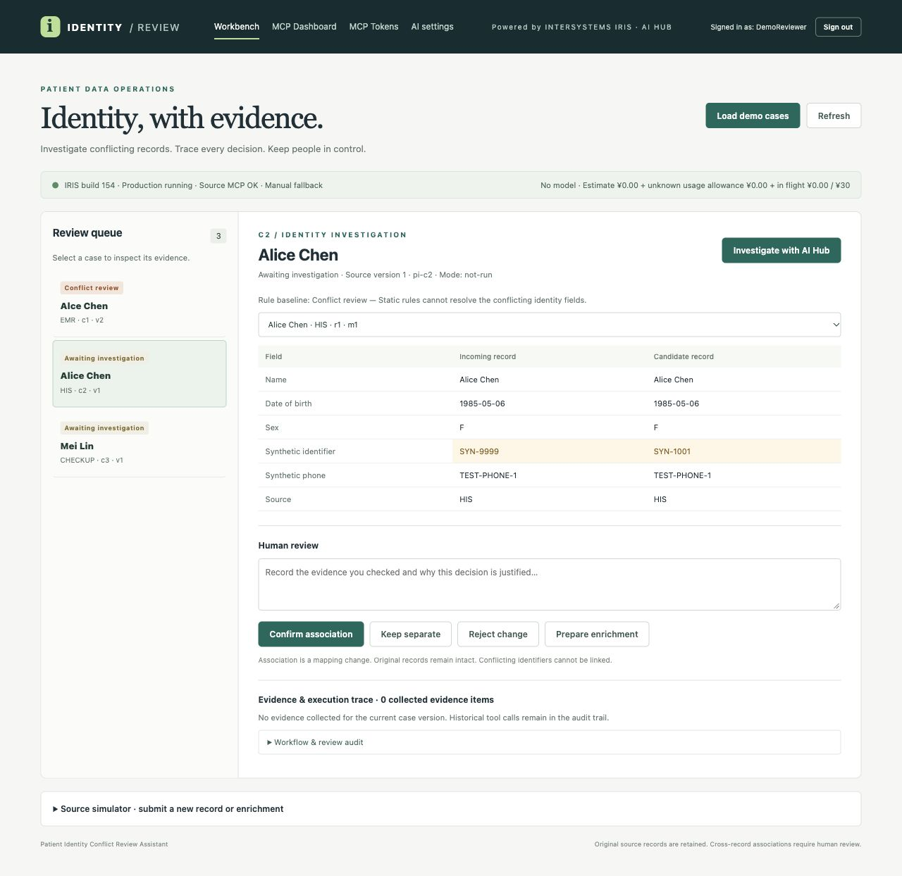
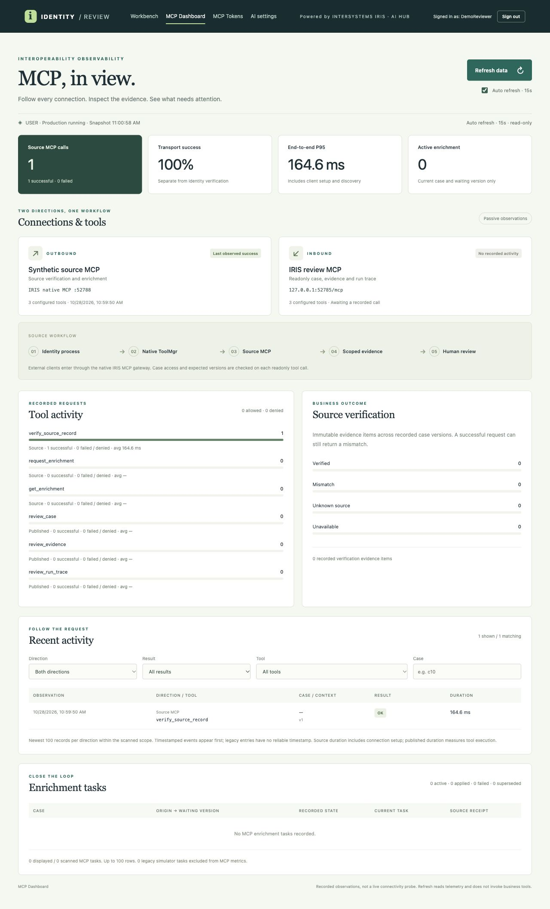
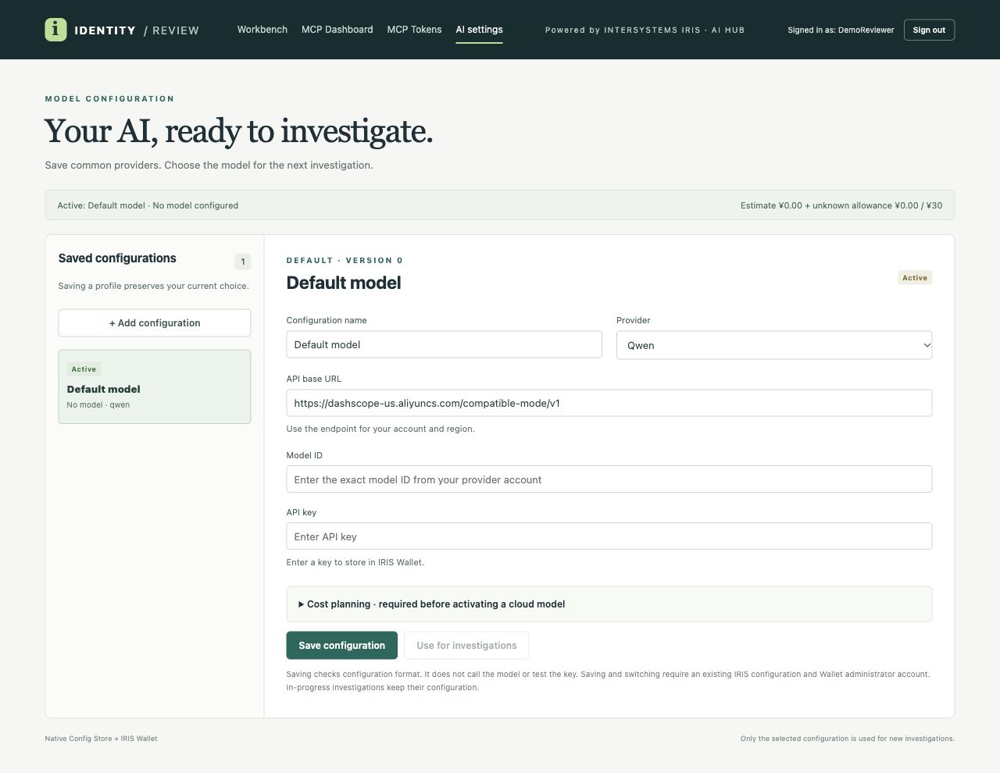
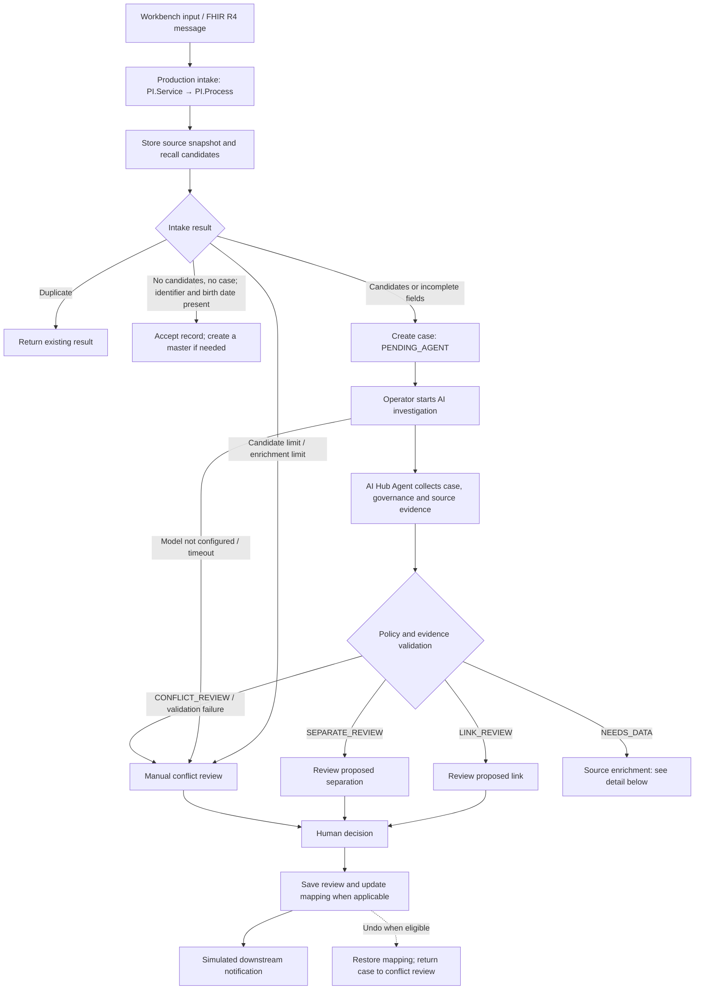
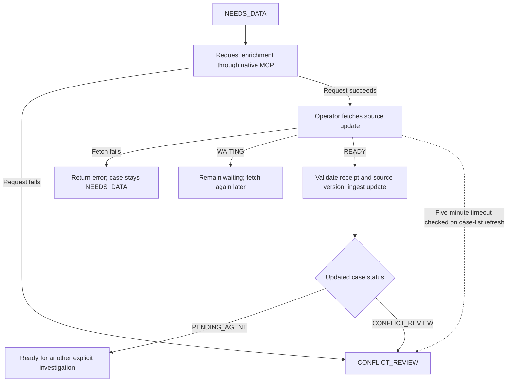
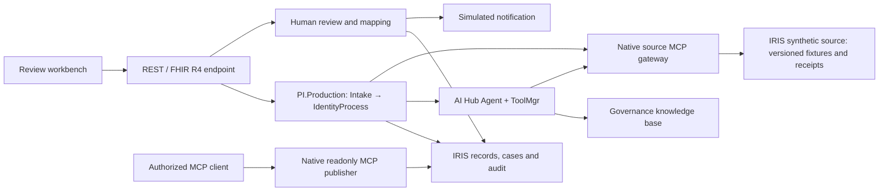

# PI Review

English | [简体中文](README.zh-CN.md)

[](https://openexchange.intersystems.com/contest/49)
[](LICENSE)

**PI Review** stands for Patient Identity Conflict Review Assistant.

An InterSystems IRIS interoperability demo in which an AI Hub agent investigates **synthetic** patient identity conflicts, gathers scoped source evidence and recommends a route for human review. A reviewer retains control of identity mappings; the agent cannot approve a merge.

> **Contest entry:** [InterSystems Programming Contest — AI Agents in Interoperability Workflows](https://openexchange.intersystems.com/contest/49). This project shows how an AI Agent integrated into an IRIS production workflow can handle a high-stakes decision task — identity conflict resolution — with tool-constrained evidence collection, governance knowledge retrieval, and human-in-the-loop review.

This repository is a **fresh installation**. It contains no historical database, patient records, user credentials or EAP image. The source MCP server is implemented in ObjectScript on IRIS and exposed through native `iris-mcp-server`; a Python source service or SQLite database is not required.

## Screenshots

The screenshots below use synthetic demo cases in a local instance. The model is not configured in this example.

**Identity review workbench**



**MCP dashboard**



**AI settings**



> **Video demo:** *[TODO: add link to video walkthrough]*

## Contents

- [Business workflow](#business-workflow)
- [System architecture](#system-architecture)
- [AI Hub and interoperability features](#ai-hub-and-interoperability-features)
- [IRIS Agentic Dev](#iris-agentic-dev)
- [Requirements](#requirements)
- [Start from an empty environment](#start-from-an-empty-environment)
- [Configure a model](#configure-a-model)
- [Demonstration](#demonstration)
- [Verification](#verification)
- [Contributors](#contributors)

## Business workflow

The diagram follows the implemented intake, investigation, enrichment and review paths. AI investigation is started explicitly; loading demo cases does not call a model.



The workbench shows the rule-based baseline separately from the agent recommendation, together with case-scoped evidence, source calls and review history. Source changes are checked again before applying a result. An unavailable source during investigation or enrichment request routes to conflict review; an error while fetching an update is returned to the caller and does not itself change the waiting case. Enrichment is limited to two rounds; a five-minute timeout is evaluated when the case list is refreshed. Undo is subject to case and source-version checks.

### Enrichment detail



## System architecture



The two MCP paths have different roles: the **source MCP** verifies synthetic source records and handles enrichment; the **readonly publisher** exposes authorized case, evidence and run-trace views to MCP clients. Both use IRIS-native MCP services behind `iris-mcp-server` gateways. The source service runs in the same IRIS instance as the application; it reads synthetic fixtures and stores request receipts in IRIS. It is not an independent hospital system.

### MCP tools, ports and authorization

| Path | Tools | Gateway and access |
| --- | --- | --- |
| Source MCP | `verify_source_record`, `request_enrichment`, `get_enrichment` | A shared container-loopback gateway at `127.0.0.1:52788/mcp` serves USER and PITEST; it is not published as a host port. |
| Readonly publisher | `review_case`, `review_evidence`, `review_run_trace` | Host loopback `127.0.0.1:52785/mcp` by default; `PI_MCP_PORT` changes the host port. The test publisher uses `PI_MCP_TEST_PORT` and the `test` Compose profile. |

For source calls, the business code uses `%AI.ToolMgr` to call the local gateway. The client and source service share the source Bearer credential; USER and PITEST use **different HMAC signing keys**. A short-lived signed capability binds the namespace, case and source versions, action and expiry; enrichment capabilities also bind the request and missing fields. The source service checks the signature and scope, while the caller checks the returned scope and receipt. Tool discovery can list both namespaces, but does not grant access. The shared gateway is a common point of failure for both namespaces.

The readonly publisher uses a separate client Bearer token and per-case authorization. Each read checks the token's current status, case grant and expected case version; discovery alone does not grant access. Readonly means no exposed case mutation, not anonymization: authorized responses may include synthetic identity fields. Published gateway tool names have a prefix, for example `mcp_identity_review_case`.

The MCP dashboard displays bounded observations from recorded calls and the Production state. It does not actively probe MCP endpoints, so a previous successful observation is not proof that a gateway is currently healthy.

## AI Hub and interoperability features

- Native `%AI.Agent` and persistent sessions; the next investigation can resume a prior session with fresh case evidence.
- `%AI.ToolMgr` and authorization policies constrain tools to the current case, source version and run.
- Native embeddings, vector store and knowledge base retrieve synthetic governance rules with evidence provenance.
- Config Store and Wallet manage model profiles and secrets; model and endpoint can be configured in the settings page.
- IRIS-native MCP source tools verify source records and support idempotent enrichment requests. Separate USER and PITEST endpoints use distinct signing keys, a bearer credential and bounded capability scopes.
- A second native MCP service publishes readonly case, evidence and run-trace tools with per-case access control. The workbench includes an MCP dashboard and token management.
- The synchronous `/identity-fhir/$process-message` endpoint accepts the supported FHIR R4 message Bundle profile with `MessageHeader` and `Patient`, returns a FHIR message response, and uses `OperationOutcome` for errors. This is a focused demo profile, not a complete FHIR server.

The FHIR operation requires `application/fhir+json` and the local mutation header `X-Identity-Review: local-demo`. It accepts one focused `Patient`, the `patient-upsert` event and at most 20 Bundle entries within 64 KiB. Supported source endpoints are `urn:pi:source:HIS`, `urn:pi:source:EMR` and `urn:pi:source:CHECKUP`; supplied identifiers use the synthetic `SYN-` prefix. It is synchronous; unsupported fields or conflicting message IDs are rejected. Identical message retries return the stored response.

## IRIS Agentic Dev

[IRIS Agentic Dev](https://github.com/intersystems-community/iris-agentic-dev) is an **optional development tool** that connects a coding assistant to a running IRIS instance. It can inspect classes and interoperability components, compile ObjectScript and help diagnose tests. It is separate from this application's source MCP and readonly publisher, and is not required to run the demo.

To connect it to this project using VS Code and GitHub Copilot:

1. Start the application as described in [Start from an empty environment](#start-from-an-empty-environment). The IRIS web port is `127.0.0.1:52784` by default; if `PI_PORT` was changed, use that host port. `docker compose port iris 52773` shows the active mapping.
2. Install the [InterSystems ObjectScript extension](https://marketplace.visualstudio.com/items?itemName=intersystems-community.vscode-objectscript) and [iris-agentic-dev for IRIS](https://marketplace.visualstudio.com/items?itemName=intersystems-community.vscode-iris-agentic-dev), then reload VS Code. Configure an IRIS connection in InterSystems Server Manager or `objectscript.conn`: host `127.0.0.1`, web port `52784` (or your mapped port), and namespace `USER`. Use an authorized IRIS development account with the permissions needed for the intended operations; manage its credentials locally rather than committing them.
3. Open Copilot Chat in Agent mode, enable the `iris-agentic-dev` tools, and ask it to call `check_config`. Check the reported host, port, namespace and account before proceeding. Availability of particular tools depends on the account, server policy and connection; for interoperability and container tools, set `iris-agentic-dev.toolset` to `merged` and, where required, set `iris-agentic-dev.containerName` to the IRIS container name (`pi-native-review` by default; use the configured `PI_CONTAINER` if changed).
4. Try a scoped request such as: “Inspect `PI.Production` and explain how it routes requests to the source MCP tools,” or “Inspect `PI.FHIR.REST` and `PI.FHIR.Message` and summarize the supported FHIR message flow.” Review the returned findings against the project sources. For tests and deployment, continue to use this repository's [verification commands](#verification).

The tool can also be installed as a CLI or connected to other MCP-compatible coding clients; see the [upstream installation and connection guide](https://github.com/intersystems-community/iris-agentic-dev#connecting-to-iris). This repository does not bundle or configure Agentic Dev, and this guide does not assert that Agentic Dev was used to build the submitted features.

## Requirements

- Docker and Docker Compose, with sufficient memory for IRIS and the local embedding model.
- The InterSystems AI Hub EAP Community image `2026.3.0AI.154.0` for your architecture. Load it locally from the [AI Hub EAP portal](https://evaluation.intersystems.com/Eval/early-access/AIHub). Do not publish the EAP image or derived images.
- Python 3, `curl` and an internet connection for the first public embedding-model download.
- An OpenAI-compatible provider is optional; opening the demo and running the default tests do not call a paid model.

## Start from an empty environment

```bash
# Load the architecture-specific EAP archive first, then tag the loaded image.
docker image load -i <your-iris-eap-image.tar.gz>
docker tag <actual-loaded-image-name> iris-community:2026.3.0AI.154.0
cp .env.example .env
chmod 600 .env
bash scripts/bootstrap.sh
```

Open <http://127.0.0.1:52784/identity/> and sign in with an existing IRIS administrator account that has `%Admin_ConfigStore` and `%Admin_Wallet` permissions. The settings page is `/identity/settings`, and the MCP dashboard is `/identity/mcp`. Ports are loopback-only; configure `PI_PORT`, `PI_MCP_PORT`, and `PI_MCP_TEST_PORT` in `.env` to avoid collisions. USER and PITEST have separate storage. Re-running bootstrap preserves this installation's data and existing credentials.

The default Compose project is `patient-identity-native` and the default IRIS container is `pi-native-review`, separate from the earlier prototype. For another isolated installation, set a unique `COMPOSE_PROJECT_NAME`, `PI_CONTAINER` and three available port values before bootstrapping. Reusing a Compose project name reuses its volumes.

Normal operation uses three long-running containers: IRIS, one shared source MCP gateway and the readonly publisher gateway. `init-durable` is a one-shot permissions initializer; `mcp-gateway-test` runs only with the test profile.

The Production is configured to auto-start with IRIS. For a planned restart use `docker compose --profile native restart iris`, which also restarts the dependent gateways. After an external Docker or host restart, run `bash scripts/bootstrap.sh` to recreate and verify the gateways in IRIS's network namespace.

The first bootstrap downloads a pinned public `Qdrant/all-MiniLM-L6-v2-onnx` embedding model (approximately 91 MB), records file hashes under ignored `artifacts/`, then copies it into the IRIS volume. Python is retained for model caching, configuration and local test/administration utilities; it is not the source MCP server.

## Configure a model

For first-time bootstrap, set `PI_API_KEY`, `PI_BASE_URL`, `PI_MODEL` and `PI_LIVE_ENABLED=1` in the ignored `.env` file, or configure a profile through the settings page. Once the default configuration exists, bootstrap does not overwrite it from `.env`; use the settings page for later endpoint, model or key changes. `PI_LIVE_ENABLED` is a container environment setting, so rerun bootstrap after changing it. Do not commit `.env`, generated Wallet files or client tokens. The project uses a local CNY 30 evaluation budget and conservative estimated pricing; this is a demo limit, not a provider billing guarantee. Review actual provider charges and rates before running live investigations.

## Demonstration

1. Sign in and select **Load demo cases**. This creates synthetic cases without calling a model.
2. Investigate the spelling discrepancy and inspect source verification, governance evidence and the recommendation.
3. Review the recommendation and confirm or reject it as a human. The workbench records the decision and supports undo with a reason.
4. Investigate a case with missing fields, request enrichment, fetch the next simulated source version through native MCP, and investigate again.
5. Open the MCP dashboard to inspect recorded source and publisher observations and call traces.

The readonly publisher is available at `http://127.0.0.1:52785/mcp` by default. The initial local-reviewer client configuration is generated in `artifacts/mcp-client.json` with mode 0600. No USER case grant is created automatically. The trusted local command `python3 scripts/mcp_client.py --grant <case-id>` grants an existing case only to the initial `local-reviewer` identity; use MCP settings to grant cases to other managed tokens.

If the initial local-reviewer token is revoked, bootstrap does not re-enable it. It reports `PUBLISH_CLIENT_REVOKED` and checks transport reachability only; create a new client token with the needed case grants in MCP settings. Save that token and publisher URL in a separate private JSON configuration (`url` and `token` fields), then pass its path using `python3 scripts/mcp_client.py --config <private-config>`. Bootstrap regenerates the initial `artifacts/mcp-client.json`, so it must not be used to store a replacement token.

## Verification

After bootstrap, these checks use synthetic data and no paid model calls:

```bash
bash scripts/test.sh
bash scripts/mcp-test.sh
python3 -m unittest discover -s tests -p fhir_http_acceptance.py
```

Tests write to the isolated PITEST namespace; HTTP acceptance tests create and clean up temporary local identities. The FHIR HTTP test sends synthetic messages to the local Production. The test-only publisher gateway may be stopped after tests. Source unavailability is simulated with a PITEST-only maintenance gate, so the shared gateway remains available to USER; this does not simulate a network outage. If the test is interrupted or cleanup fails, retain its `TEST_MAINTENANCE_OWNER` value. In a PITEST IRIS session run `do ##class(PI.MCP.SourceGate).LeaveMaintenance("<owner>")` with that exact value after confirming the test is no longer running. This cannot clear another owner’s marker. `mcp-test.sh` detects the configured host ports. For the standalone FHIR HTTP test, set `PI_BASE` to the configured HTTP origin when using a non-default port.

The demo is not production medical software. It does not establish real patient identity, connect to a hospital, replace human review, or provide a complete FHIR implementation. Secure deployment, provider pricing, real data access controls and clinical governance require separate validation.

## Contributors

- [John Pan](https://community.intersystems.com/user/john-pan)
