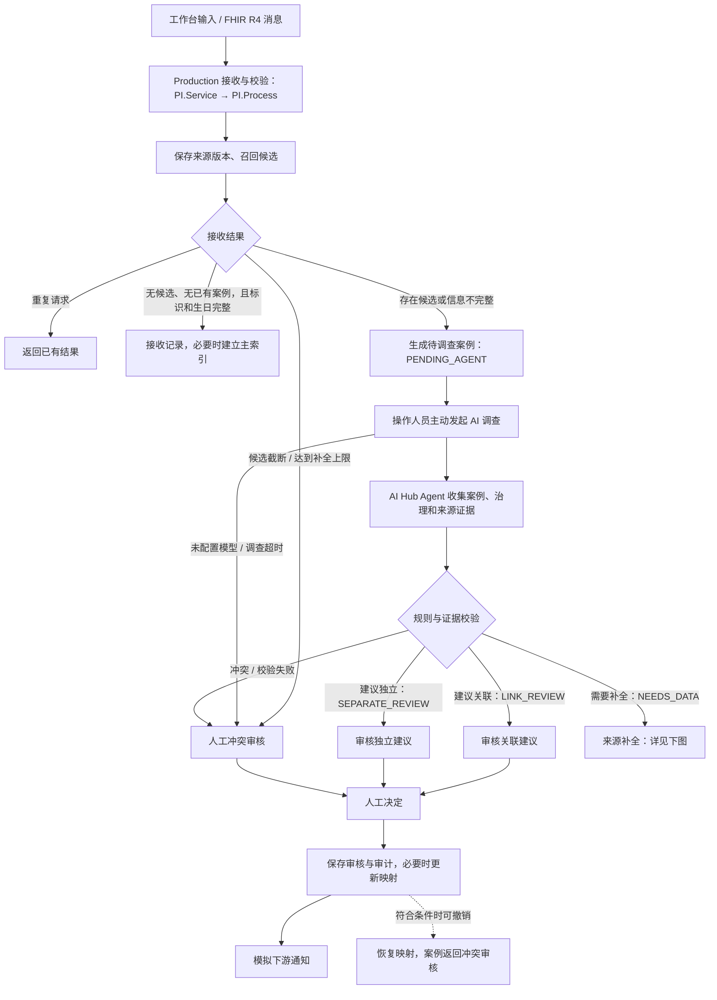
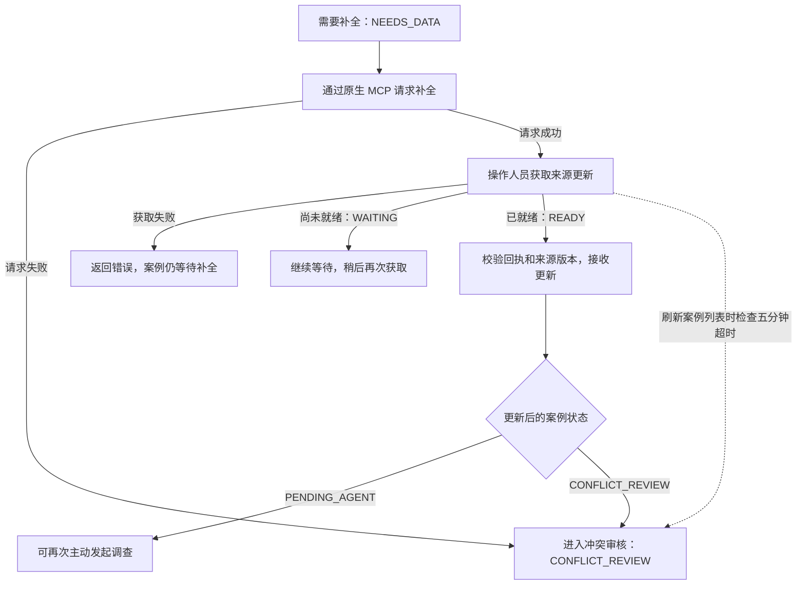
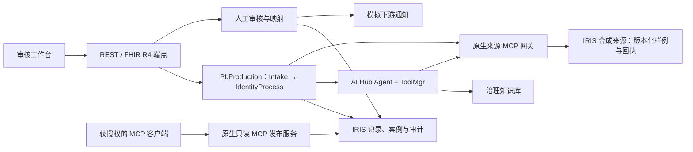

# PI Review

全称：Patient Identity Conflict Review Assistant（患者身份冲突审核助手）

[English](README.md) | 简体中文

[](https://openexchange.intersystems.com/contest/49)
[](LICENSE)

这是一个基于 InterSystems IRIS 互操作能力的演示项目。AI Hub Agent 调查 **合成患者身份数据**中的冲突，收集限定于当前案例的来源证据，并提出供人工审核的处理建议。身份映射由审核人员控制，Agent 不能自行批准合并。

> **竞赛作品：** [InterSystems 编程大赛 — 互操作性工作流中的 AI Agent](https://openexchange.intersystems.com/contest/49)。本项目展示了 AI Agent 如何集成到 IRIS 生产工作流中，通过工具受限的证据收集、治理知识检索和人工闭环审核，处理身份冲突解决这一高风险决策任务。

本仓库按**全新安装**准备，不包含历史数据库、真实患者记录、用户凭据或 EAP 镜像。来源 MCP Server 使用 IRIS ObjectScript 实现，并通过原生 `iris-mcp-server` 发布；运行时不需要 Python 来源服务或 SQLite 数据库。

## 截图

以下截图来自本地演示实例，使用合成案例；截图时未配置模型。

**身份审核工作台**


**MCP 仪表盘**


**AI 设置**


> **视频演示：** [在 YouTube 观看演示视频](https://youtu.be/1N-tYLTfEGY)

## 目录

- [业务流程](#业务流程)
- [系统架构](#系统架构)
- [AI Hub 与互操作功能](#ai-hub-与互操作功能)
- [IRIS Agentic Dev](#iris-agentic-dev)
- [环境要求](#环境要求)
- [从空环境开始安装](#从空环境开始安装)
- [配置模型](#配置模型)
- [演示步骤](#演示步骤)
- [验证](#验证)
- [贡献者](#贡献者)

## 业务流程

下图对应当前实现中的接收、调查、补全和审核流程。AI 调查需要人工主动发起；加载演示案例不会调用模型。



工作台分别展示规则基线与 Agent 建议，并提供案例证据、来源调用和审核记录。应用结果前会再次检查来源变化。调查或发起补全请求时来源不可用会转入冲突审核；获取补全结果时发生错误则返回错误，不会仅因此改变等待补全的案例状态。补全最多两轮，五分钟超时在刷新案例列表时检查；撤销操作受案例状态和来源版本约束。

### 补全流程详解



## 系统架构



两条 MCP 路径的职责不同：**来源 MCP** 用于验证合成来源记录和处理补全；**只读 MCP 发布服务**向获授权的 MCP 客户端提供案例、证据和运行轨迹。两者均使用 IRIS 原生 MCP 服务，并通过 `iris-mcp-server` 网关发布。来源服务与应用运行在同一 IRIS 实例内，读取合成样例并在 IRIS 中保存请求回执，并非独立医院系统。

### MCP 工具、端口与授权

| 路径 | 工具 | 网关与访问方式 |
| --- | --- | --- |
| 来源 MCP | `verify_source_record`、`request_enrichment`、`get_enrichment` | USER 和 PITEST 共用容器回环网关 `127.0.0.1:52788/mcp`；不映射为宿主机端口。 |
| 只读发布服务 | `review_case`、`review_evidence`、`review_run_trace` | 宿主机默认回环地址为 `127.0.0.1:52785/mcp`，可用 `PI_MCP_PORT` 修改宿主机端口。测试发布服务使用 `PI_MCP_TEST_PORT` 和 Compose 的 `test` profile。 |

来源调用由业务代码通过 `%AI.ToolMgr` 访问本机网关。客户端与来源服务使用同一份来源 Bearer 凭据；USER 和 PITEST 的 **HMAC 签名密钥不同**。短期签名能力凭证绑定命名空间、案例和来源版本、操作及有效期；补全凭证还绑定请求和缺失字段。来源服务校验签名和范围，调用方校验返回范围及回执。工具发现可能列出两个命名空间的工具，但不意味着获得访问权限；共享网关故障会同时影响两个命名空间。

只读发布服务使用独立的客户端 Bearer Token 和按案例授权。每次读取都会检查 Token 当前状态、案例授权和预期案例版本；发现工具本身不等于获得案例权限。只读表示不提供案例写入，并不代表数据脱敏：获授权的响应可能包含合成身份字段。网关发布的工具名会带前缀，例如 `mcp_identity_review_case`。

MCP 仪表盘展示有上限的历史调用观测和 Production 状态，不主动探测 MCP 端点；过去一次成功记录不能证明网关当前健康。

## AI Hub 与互操作功能

- 原生 `%AI.Agent` 与持久会话：后续调查可以恢复已有会话，并获取当前案例的新证据。
- `%AI.ToolMgr` 与授权策略：将工具调用限制在当前案例、来源版本和运行范围内。
- 原生嵌入、向量存储与知识库：检索合成治理规则，并保留证据来源。
- Config Store 与 Wallet：管理模型配置和密钥；可在设置页面配置模型和端点。
- IRIS 原生来源 MCP：验证来源记录并以幂等方式处理补全请求。USER 与 PITEST 使用独立端点、独立签名密钥、Bearer 凭据和受限能力范围。
- 原生只读 MCP 发布服务：提供按案例授权的案例、证据和运行轨迹工具；工作台提供 MCP 仪表盘和 Token 管理。
- 同步 `/identity-fhir/$process-message` 端点：接受本项目支持的 FHIR R4 消息 Bundle，包含 `MessageHeader` 和 `Patient`；返回 FHIR 消息响应，错误使用 `OperationOutcome`。这是限定范围的演示消息规范，不是完整的 FHIR 服务器。
- Embedded Python 在候选比较工具中增加姓名相似度辅助证据；不同标识符仍禁止关联，只读页面重放已保存的解释结果。
- 原生 Workflow Engine 任务通过 Production 分发，支持明确的审核成员关系、领取、快照复核及提交后的任务完成恢复。

FHIR 操作要求 `application/fhir+json` 和本地写入请求头 `X-Identity-Review: local-demo`。消息包含一个被 focus 引用的 `Patient`、`patient-upsert` 事件，Bundle 最多 20 个条目、大小不超过 64 KiB。支持的来源端点为 `urn:pi:source:HIS`、`urn:pi:source:EMR` 和 `urn:pi:source:CHECKUP`；如提供标识，其值须使用合成数据前缀 `SYN-`。操作为同步处理；不支持的字段或冲突的消息 ID 会被拒绝。完全相同的消息重试会返回已保存的响应。

## IRIS Agentic Dev

[IRIS Agentic Dev](https://github.com/intersystems-community/iris-agentic-dev) 是**可选的开发工具**，用于让编程助手连接正在运行的 IRIS，辅助检查类和互操作组件、编译 ObjectScript、分析测试问题。它与本项目运行时的来源 MCP、只读 MCP 发布服务分别独立，运行演示不要求安装它。

以下以 VS Code 和 GitHub Copilot 为例连接本项目：

1. 按[从空环境开始安装](#从空环境开始安装)启动项目。IRIS Web 默认地址为 `127.0.0.1:52784`；若修改了 `PI_PORT`，请使用实际宿主机端口。可执行 `docker compose port iris 52773` 查看当前映射。
2. 安装 [InterSystems ObjectScript 扩展](https://marketplace.visualstudio.com/items?itemName=intersystems-community.vscode-objectscript)和 [iris-agentic-dev for IRIS 扩展](https://marketplace.visualstudio.com/items?itemName=intersystems-community.vscode-iris-agentic-dev)，然后重新加载 VS Code。在 InterSystems Server Manager 或 `objectscript.conn` 中配置连接：主机 `127.0.0.1`、Web 端口 `52784`（或实际映射端口）、命名空间 `USER`。使用针对所需操作具有相应权限的 IRIS 开发账号，在本地管理凭据，不要提交到仓库。
3. 在 Copilot Chat 中选择 Agent 模式，启用 `iris-agentic-dev` 工具，并要求助手调用 `check_config`。继续前核对返回的主机、端口、命名空间和账号。工具能否使用取决于账号权限、服务端策略与连接方式；如需互操作和容器工具，可将 `iris-agentic-dev.toolset` 设为 `merged`；需要容器访问的工具还应设置 `iris-agentic-dev.containerName` 为 IRIS 容器名（默认 `pi-native-review`，修改过时使用配置的 `PI_CONTAINER`）。
4. 可从限定范围的请求开始，例如：“检查 `PI.Production`，解释请求如何流向来源 MCP 工具”，或“检查 `PI.FHIR.REST` 和 `PI.FHIR.Message`，总结支持的 FHIR 消息流程”。结合项目源码核对结果；项目测试及部署仍按本仓库的[验证命令](#验证)进行。

也可安装命令行工具或连接其他兼容 MCP 的编程客户端，具体见[上游安装和连接指南](https://github.com/intersystems-community/iris-agentic-dev#connecting-to-iris)。本仓库不包含 Agentic Dev，也不会自动配置它；上述说明不表示提交的功能已经使用该工具开发。

## 环境要求

- Docker 和 Docker Compose，并为 IRIS 与本地嵌入模型预留足够内存。
- 与本机架构匹配的 InterSystems AI Hub EAP Community 镜像 `2026.3.0AI.154.0`。从 [AI Hub EAP 门户](https://evaluation.intersystems.com/Eval/early-access/AIHub) 获取并加载到本地。请勿公开发布 EAP 镜像或其衍生镜像。
- Python 3、`curl`；首次下载公共嵌入模型需要联网。
- OpenAI 兼容的模型服务为可选项；打开演示和运行默认测试不会调用付费模型。

## 从空环境开始安装

```bash
# 先加载与架构匹配的 EAP 镜像归档，再为实际加载的镜像打标签。
docker image load -i <your-iris-eap-image.tar.gz>
docker tag <actual-loaded-image-name> iris-community:2026.3.0AI.154.0
cp .env.example .env
chmod 600 .env
bash scripts/bootstrap.sh
```

访问 <http://127.0.0.1:52784/identity/>，使用已有的 IRIS 管理员账号登录；该账号需要 `%Admin_ConfigStore` 和 `%Admin_Wallet` 权限。初始化脚本会关闭本地演示账号 `_SYSTEM` 的首次登录强制改密要求，保留其已有密码和角色；全新安装使用所加载镜像的初始凭据。AI 设置页面为 `/identity/settings`，MCP 仪表盘为 `/identity/mcp`。端口只绑定本机回环地址；可在 `.env` 中设置 `PI_PORT`、`PI_MCP_PORT` 和 `PI_MCP_TEST_PORT` 避免冲突。USER 与 PITEST 使用独立存储。重复执行初始化会保留本安装的数据和已有凭据。

默认 Compose 项目名为 `patient-identity-native`，默认 IRIS 容器名为 `pi-native-review`，与早期原型分开。若需要另一套隔离安装，请在启动前设置唯一的 `COMPOSE_PROJECT_NAME`、`PI_CONTAINER` 和三个可用端口。复用 Compose 项目名会复用其数据卷。

正常运行时有三个长期容器：IRIS、共享来源 MCP 网关和只读发布网关。`init-durable` 是一次性权限初始化容器；`mcp-gateway-test` 仅在测试配置下运行。

Production 配置为随 IRIS 自动启动。计划内重启可执行 `docker compose --profile native restart iris`，同时重启依赖的网关。若由外部 Docker 操作或主机重启，请执行 `bash scripts/bootstrap.sh`，在 IRIS 网络命名空间中重新创建并验证网关。

首次初始化会下载固定版本的公共模型 `Qdrant/all-MiniLM-L6-v2-onnx`（约 91 MB），在被 Git 忽略的 `artifacts/` 中记录文件哈希，再复制到 IRIS 数据卷。Python 用于模型缓存、配置以及本地测试和管理工具，并非来源 MCP Server。

## 配置模型

首次初始化时，可在被 Git 忽略的 `.env` 中设置 `PI_API_KEY`、`PI_BASE_URL`、`PI_MODEL` 和 `PI_LIVE_ENABLED=1`，也可以在设置页面配置模型。默认配置建立后，重新初始化不会用 `.env` 覆盖它；后续修改端点、模型或密钥请使用设置页面。`PI_LIVE_ENABLED` 是容器环境设置，修改后需要重新运行初始化。不要提交 `.env`、生成的 Wallet 文件或客户端 Token。本项目使用 3 美元的本地评估预算和保守估算价格；这是演示限制，不保证与服务商账单完全一致。实际调查前请核对服务商的价格和费用。

## 演示步骤

1. 登录后选择 **Load demo cases**，无需调用模型即可生成合成案例。
2. 调查姓名拼写差异，查看来源核验、治理证据和建议。
3. 点击 **Claim review task** 领取原生任务，再由人工审核建议并确认或拒绝。默认本地审核成员为已有的 `_SYSTEM` 账号。工作台会记录决定，并支持填写理由后撤销；来源变化会使旧任务失效。
4. 调查字段缺失的案例，请求补全，通过原生 MCP 获取下一个模拟来源版本，再次发起调查。
5. 打开 MCP 仪表盘，查看来源服务、发布服务的历史观测和调用轨迹。

只读发布服务默认地址为 `http://127.0.0.1:52785/mcp`。初始 `local-reviewer` 客户端配置生成在本地 `artifacts/mcp-client.json`，权限为 0600。USER 中不会自动授予任何案例。可信本地管理员命令 `python3 scripts/mcp_client.py --grant <case-id>` 只为初始 `local-reviewer` 身份授予已有案例；其他受管理 Token 的案例授权应在 MCP 设置中配置。

如果初始 `local-reviewer` Token 已被撤销，初始化不会重新启用它。启动过程会显示 `PUBLISH_CLIENT_REVOKED`，此时只检查传输可达性；请在 MCP 设置中创建新 Token 并配置所需案例授权。将新 Token 和发布地址保存在单独的私有 JSON 配置中（字段为 `url` 和 `token`），再通过 `python3 scripts/mcp_client.py --config <private-config>` 指定该文件。初始化会重新生成初始的 `artifacts/mcp-client.json`，因此不要将替代 Token 保存到该文件。

## 验证

初始化完成后，下列检查使用合成数据，不调用付费模型：

```bash
bash scripts/test.sh
bash scripts/mcp-test.sh
python3 -m unittest discover -s tests -p fhir_http_acceptance.py
```

测试向隔离的 PITEST 命名空间写入数据；HTTP 验收会创建并清理临时本地身份。FHIR HTTP 测试会向本地 Production 发送合成消息。测试结束时可能停止测试用只读发布网关。来源不可用场景通过仅针对 PITEST 的维护开关模拟，共享网关仍服务于 USER；该测试不模拟网络中断。如果测试被中断或清理失败，请保留输出的 `TEST_MAINTENANCE_OWNER`，确认测试已停止后，在 PITEST IRIS 会话运行 `do ##class(PI.MCP.SourceGate).LeaveMaintenance("<owner>")`，将 `<owner>` 替换为该值。该操作不能清除其他持有者的标记。`mcp-test.sh` 会检测配置的宿主机端口；如果 HTTP 使用非默认端口，单独运行 FHIR HTTP 测试时应将 `PI_BASE` 设置为对应的 HTTP 源地址。

本演示不是生产医疗软件，不能据此确认真实患者身份，不连接医院，不替代人工审核，也不是完整的 FHIR 实现。安全部署、服务商价格、真实数据访问控制和临床治理需要另行验证。

## 贡献者

- [John Pan](https://community.intersystems.com/user/john-pan)
